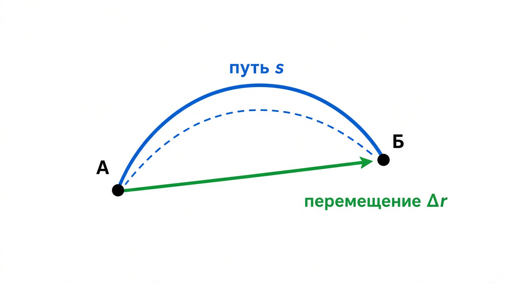
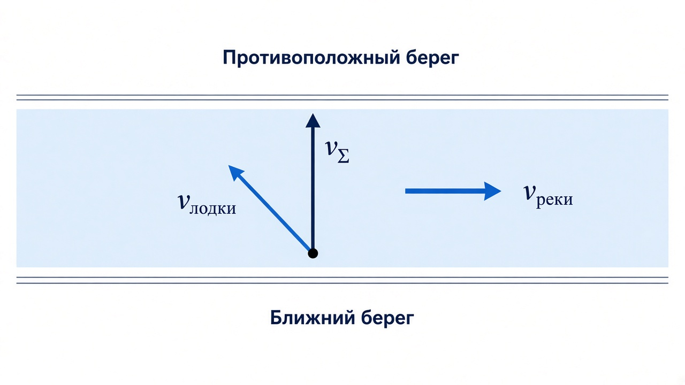
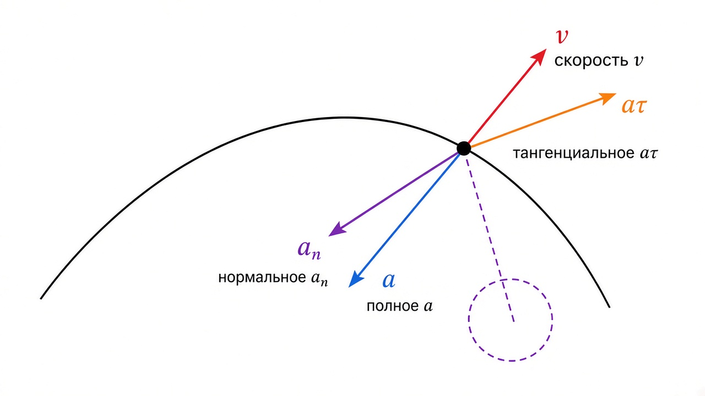
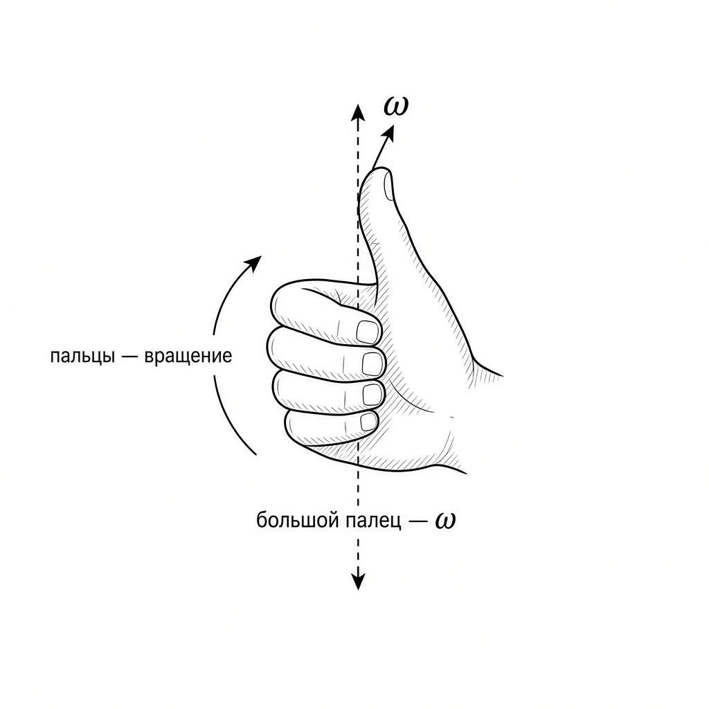
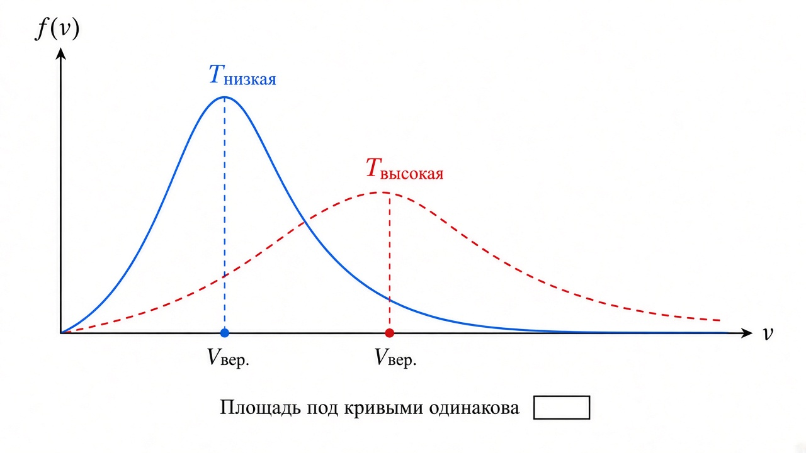

# Физика. Механика — конспект

Материалы: лекции 2–4, практики 1.1 / 2 / 3 / 5, выжимка УрФУ, задания курса.

**Как читать:** в каждом разделе сначала блок «На пальцах», потом формулы, потом типичные ловушки.  
Подробные формулы для решения задач — в файле [`Формулы.md`](Формулы.md).

---

## Оглавление

1. [Кинематика](#1-кинематика)
2. [Динамика и силы](#2-динамика-и-силы)
3. [Работа и энергия](#3-работа-и-энергия)
4. [Импульс и удары](#4-импульс-и-удары)
5. [Вращение](#5-вращение)
6. [Колебания и волны](#6-колебания-и-волны)
7. [СТО и релятивистская динамика](#7-сто-и-релятивистская-динамика)
8. [МКТ: Максвелл и энтропия](#8-мкт-максвелл-и-энтропия)
9. [Шпаргалка по задачам](#9-шпаргалка-по-задачам)
10. [Чек-лист ошибок](#10-чек-лист-ошибок)

---

## Константы

```
g ≈ 9,8 м/с²          G ≈ 6,67·10⁻¹¹ Н·м²/кг²
c = 3·10⁸ м/с         1 рад ≈ 57,3°
1 об/мин ≈ 0,105 рад/с
```

---

# 1. Кинематика

## 1.1. Основы

### На пальцах

Представь, что ты описываешь, **где** и **как** движется тело, **не спрашивая**, почему (силы — это уже динамика).

- **Система отсчёта** = «относительно чего смотрим» + оси координат + часы.  
  Без СО фраза «машина едет со скоростью 60» бессмысленна: относительно дороги? поезда? Земли?
- **Материальная точка** — тело, у которого в задаче не важны размеры (Земля вокруг Солнца — точка; мяч в комнате — обычно тоже).
- **Траектория** — линия, по которой «проехал» объект.

Положение задают:
1. радиус-вектором `r` (стрелка из начала координат к точке);
2. координатами `(x, y, z)`.

```
r = x·i + y·j + z·k
|r| = √(x² + y² + z²)
```

### Путь и перемещение



| | Путь s | Перемещение Δr |
|---|---|---|
| Что это | длина «пройденной дороги» | стрелка «откуда → куда» |
| Тип | скаляр, s ≥ 0 | вектор |
| Со временем | только растёт (или стоит) | может уменьшаться по модулю |

```
Δr = r₂ − r₁
```

**На пальцах:** путь — сколько намотал спидометр. Перемещение — по прямой от старта до финиша.  
Они равны **только** если ехал по прямой и не разворачивался.

### Сложение скоростей (лодка / река)



```
v = v′ + V     (при V ≪ c)
```

**На пальцах:** скорость «относительно берега» = скорость «относительно воды» + скорость течения.  
Чтобы попасть **прямо напротив**, лодку направляют чуть против течения:

```
v_Σ = √(v_лодки² − v_реки²)
```

---

## 1.2. Скорость и ускорение

### На пальцах

- **Скорость** — как быстро меняется положение.  
- **Ускорение** — как быстро меняется скорость (разогнался / затормозил / свернул).

```
⟨v⟩ = Δr/Δt                 v = dr/dt
⟨a⟩ = Δv/Δt                 a = dv/dt

|v| = √(vₓ² + vᵧ² + v_z²)
|a| = √(aₓ² + aᵧ² + a_z²)
```

Скорость всегда **по касательной** к траектории.

### Равнопеременное движение (a = const)

Вывод через интегралы (если a = const вдоль x):

```
v = v₀ + a·t
x = x₀ + v₀·t + a·t²/2
v² − v₀² = 2a·(x − x₀)
```

**На пальцах:** «формула без времени» `v² = v₀² + 2as` — когда t не дан и не нужен.

### Тангенциальное и нормальное ускорение



При кривой траектории ускорение «ломается» на два куска:

| | aτ (тангенциальное) | aₙ (нормальное) |
|---|---|---|
| Делает | меняет **как быстро** едешь | меняет **куда** едешь |
| Направление | вдоль скорости | к центру кривизны |
| Формула | aτ = dv/dt | aₙ = v²/r |

```
a = √(aτ² + aₙ²)
```

**На пальцах:**
- газ в пол по прямой → только aτ;
- равномерно по кругу → только aₙ (скорость «постоянная», но направление крутится);
- торможение на повороте → и aτ, и aₙ, полное a «назад-внутрь» (тупой угол с v).

Типы:
- равномерно прямо → aτ = 0, aₙ = 0  
- прямо с разгоном → aτ ≠ 0, aₙ = 0  
- равномерно по окружности → aτ = 0, aₙ ≠ 0  

### Ловушки кинематики

- Путь ≠ |перемещение| на кривой.  
- По окружности при |v| = const ускорение **не ноль** (есть aₙ).  
- За **n-ю секунду** считают `s(n) − s(n−1)`, а не `s(n)`.  
- Углы вращения — в **радианах**.

---

# 2. Динамика и силы

### На пальцах

Кинематика говорит «как движется». Динамика — **почему**: силы толкают и тянут.

- **ИСО** — система, где свободное тело покоится или едет равномерно прямо. В ней работает Ньютон.  
- **Масса** — «насколько тяжело разогнать» (инертность).  
- Силы III закона равны и противоположны, но действуют на **разные** тела (ты жмёшь на стену — стена жмёт на тебя).

```
F = m·a              (в ИСО; F — равнодействующая!)
F = dp/dt            (общая форма; p = m·v)
F₁₂ = −F₂₁
```

### Основные силы

```
Fупр = −k·x                    (Гук; «−» — к равновесию)
Fтр = μ·N                      (скольжение)
F = G·(m₁·m₂)/r²               (тяготение)
P = m·g
```

**Вес в лифте** (на пальцах: весы показывают, с какой силой ты давишь на пол):

| Движение лифта | Вес |
|---|---|
| покой / равномерно | Q = mg |
| вверх с ускорением | Q = m(g + a) — «тяжелее» |
| вниз с ускорением | Q = m(g − a) — «легче» |
| свободное падение | Q = 0 — невесомость |

```
v₁ = √(g₀·R)     (первая космическая)
```

### Алгоритм задачи динамики

1. Рисунок + все силы  
2. `ΣF = m·a`  
3. Ось удобно вдоль ускорения → проекции  
4. Сначала в буквах, потом числа  

---

# 3. Работа и энергия

### На пальцах

- **Работа** — «сила помогала или мешала перемещению».  
- **Энергия** — запас, который можно потратить на работу.  
- **Кинетическая** — «из-за скорости». **Потенциальная** — «из-за положения / деформации».

```
A = F·s·cosα = ∫ F·dr
N = F·v·cosα                 (мощность)
Eₖ = m·v²/2
Aвсех = ΔEₖ                  (теорема о кинетической энергии)
```

| α между F и перемещением | Работа |
|---|---|
| острый | A > 0 (помогает) |
| 90° | A = 0 |
| тупой | A < 0 (мешает, трение) |

```
Eₚ = mgh
Eₚ = k·x²/2
Eₚ = −G·(m₁·m₂)/r

Aконс = −ΔEₚ
F = −∇Eₚ
```

**Закон сохранения:**

```
без трения:     Eₖ + Eₚ = const
с трением:      Aнеконс = ΔEмех ,  Q = |Aтр|
```

**На пальцах:** съехал с горки без трения — высота «превратилась» в скорость. С трением часть ушла в тепло.

---

# 4. Импульс и удары

### На пальцах

**Импульс** `p = mv` — «количество движения». Удары удобно считать через импульс, потому что сила огромная, но короткая:

```
F·Δt = Δp
Σp = const     (если внешние силы = 0 или по нужной оси малы)
```

| Удар | Что сохраняется | Картинка |
|---|---|---|
| **Неупругий** | только импульс | слиплись, часть Eₖ → тепло |
| **Упругий** | импульс **и** Eₖ | отскочили «идеально» |

```
неупругий:  u = (m₁v₁ + m₂v₂)/(m₁ + m₂)
упругий:    u₁ = [(m₁−m₂)v₁ + 2m₂v₂]/(m₁+m₂)
            u₂ = [(m₂−m₁)v₂ + 2m₁v₁]/(m₁+m₂)
```

Частные случаи упругого: равные массы → обмен скоростями; удар о стенку → `u ≈ −v`, `Δp = 2mv`.

---

# 5. Вращение

## 5.1. Кинематика вращения

### На пальцах

Вместо «метров» — **углы**, вместо скорости — **обороты в секунду** (угловая скорость).



```
ω = dφ/dt
ε = dω/dt
```

- Пальцы по вращению → большой палец = направление **ω**.  
- Если раскручиваем (|ω|↑) → **ε** туда же, куда ω.  
- Если тормозим → ε против ω.

```
равномерно:       φ = φ₀ + ω·t
равнопеременно:   ω = ω₀ + ε·t
                  φ = φ₀ + ω₀·t + ε·t²/2

v = ω·R
aτ = ε·R
aₙ = ω²·R = v²/R

N оборотов = |Δφ| / (2π)     ← важно: |φкон − φнач|, не просто φ!
```

## 5.2. Динамика вращения

### На пальцах

Аналогия 1-в-1 с обычной динамикой:

| Поступательно | Вращательно | Смысл «на пальцах» |
|---|---|---|
| F | M = F·d | насколько сильно «крутит» |
| m | I | насколько тяжело раскрутить |
| a | ε | как быстро меняется ω |
| p = mv | L = Iω | «количество вращения» |
| F = ma | M = Iε | основной закон |

```
I = Σ mᵢ·rᵢ² = ∫ r² dm
I = I₀ + m·a²              (Штейнер: ось сдвинули параллельно)
M = I·ε = dL/dt
Eₖ(вр) = I·ω²/2
```

**Таблица I** (ось через центр, если не сказано иное):

| Тело | I |
|---|---|
| Точка на расстоянии r | m·r² |
| Обруч / тонкое кольцо | m·R² |
| Диск / цилиндр | ½ m·R² |
| Стержень (центр ⊥) | mL²/12 |
| Стержень (край ⊥) | mL²/3 |
| Шар | ⅖ m·R² |
| Полый шар | ⅔ m·R² |

### Качение

```
v = ω·R
Eₖ = mv²/2 + Iω²/2 = (mv²/2)·(1 + I/(mR²))

с горки:  диск v=√(4gh/3);  шар √(10gh/7);  обруч √(gh)
```

**На пальцах:** катящийся цилиндр внизу медленнее «просто съехавшей» точки — часть энергии ушла на раскрутку.

`Mвнеш = 0` → `I₁ω₁ = I₂ω₂` (фигуристка прижимает руки — I↓, ω↑).

---

# 6. Колебания и волны

### На пальцах

**Колебания** — туда-сюда около равновесия. Признак гармоники: ускорение всегда «к центру» пропорционально смещению: `a = −ω₀²x`.

```
x = A·cos(ω₀t + φ₀)
T = 2π√(m/k)          пружина
T = 2π√(l/g)          маятник (малые углы!)
E = kA²/2
```

Затухание: амплитуда медленно падает (`e^(−βt)`).  
Резонанс: качаешь в такт — амплитуда огромная.

**Волны** — энергия бежит по среде, сами частицы в среднем на месте (как «волна» на стадионе).

```
λ = v/ν
ξ = A·cos(ωt − kx)
струна: νₙ = n·v/(2L)
```

---

# 7. СТО и релятивистская динамика

### На пальцах

При скоростях близких к свету классика ломается:

- время у движущихся часов идёт медленнее: `Δt = γ·Δt₀`;  
- длины вдоль движения короче: `l = l₀/γ`;  
- скорости складываются не как `u′+V`, а по Лоренцу (никогда не выше c).

```
γ = 1/√(1 − V²/c²)
E = γ·m₀·c²
Eₖ = (γ − 1)·m₀·c²
p = γ·m₀·v
```

При v ≪ c всё снова становится школьным: Eₖ ≈ mv²/2.

---

# 8. МКТ: Максвелл и энтропия

### На пальцах

Молекулы имеют разные скорости. График f(v) — «сколько молекул едет с такой скоростью».



```
площадь под графиком = 1

Vвер = √(2RT/M)          пик
⟨v⟩  ≈ 1,13·Vвер
Vкв  ≈ 1,22·Vвер
Vвер < ⟨v⟩ < Vкв
```

T↑ → пик вправо и ниже. M↑ → пик влево и выше.

**Энтропия** — мера «хаоса». Больше беспорядка → больше S.

```
ΔS = ∫ δQ/T

адиабата: ΔS = 0
изобара:  ((i+2)/2)·ν·R·ln(T2/T1)
изохора:  (i/2)·ν·R·ln(T2/T1)
изотерма: ν·R·ln(V2/V1)

нагрев: ΔS = c·m·ln(T2/T1)     (T в кельвинах!)
плавление / кипение: ΔS = Q/T

КПД: η = 1 − Qхол/Qнагр
Карно: η = 1 − Tхол/Tнагр      (только Карно!)
```

---

# 9. Шпаргалка по задачам

### Наклонная плоскость
`N = mg·cosα`, `a = g(sinα − μ·cosα)`.

### Связанные тела
Уравнение на каждое тело; у идеальной нити |T| одинаков.

### Удар
Сначала импульс в проекциях → потом энергия (если упругий).

### Графики вращения
- `ε` = наклон `ω(t)`  
- `φ` = площадь под `ω(t)`  
- `M = 0` ⇔ `ε = 0` ⇔ касательная к ω горизонтальна  

### x(t) = A + Bt − Ct²
`v = B − 2Ct = 0` → момент остановки; путь до остановки = `|Δx|`.

### Свободное падение «за n-ю секунду»
`sₙ = g/2 · (n² − (n−1)²)`.

---

# 10. Чек-лист ошибок

1. Единицы: км/ч → м/с (/3,6), см → м, г → кг.  
2. Векторы — только через проекции и знаки.  
3. При трении нельзя писать `Eₖ + Eₚ = const`.  
4. Неупругий удар: Eₖ не сохраняется.  
5. Вращение: какая ось? Нужен ли Штейнер?  
6. Обороты: `N = |φкон − φнач|/(2π)`.  
7. Колебания маятника: формула только для малых углов.  
8. Максвелл: Vвер никогда не больше Vкв.  
9. Энтропия: температура в **кельвинах**.  
10. КПД `1 − Tхол/Tнагр` — только цикл Карно.  

---

## Быстрый алгоритм любой задачи

1. Данные в СИ + рисунок  
2. Модель (точка / твёрдое тело)  
3. Нужные законы (Ньютон / энергия / импульс / моменты)  
4. Решение в общем виде → числа в конце  
5. Проверка: размерность, знаки, предельные случаи  
